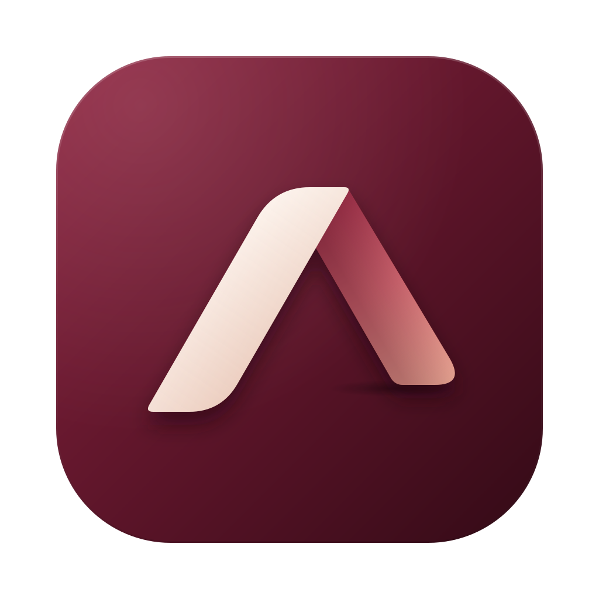
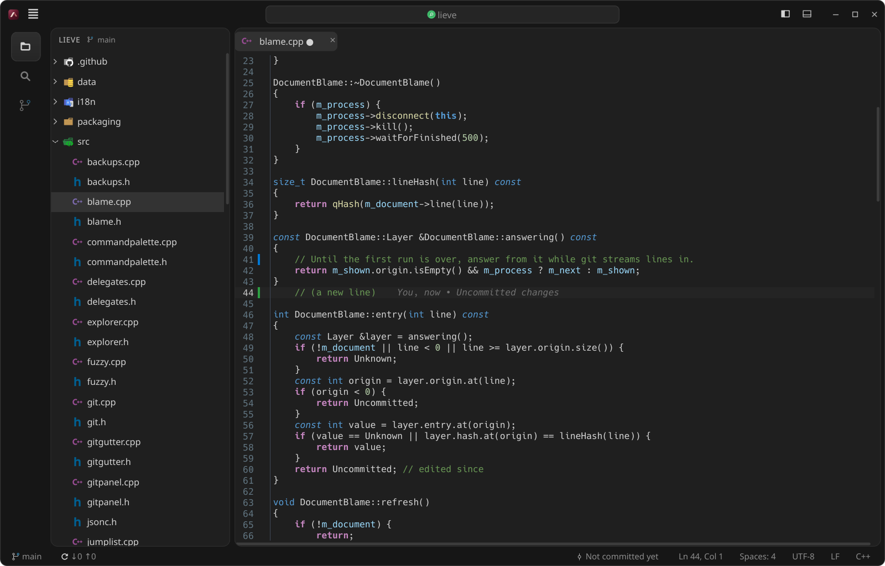
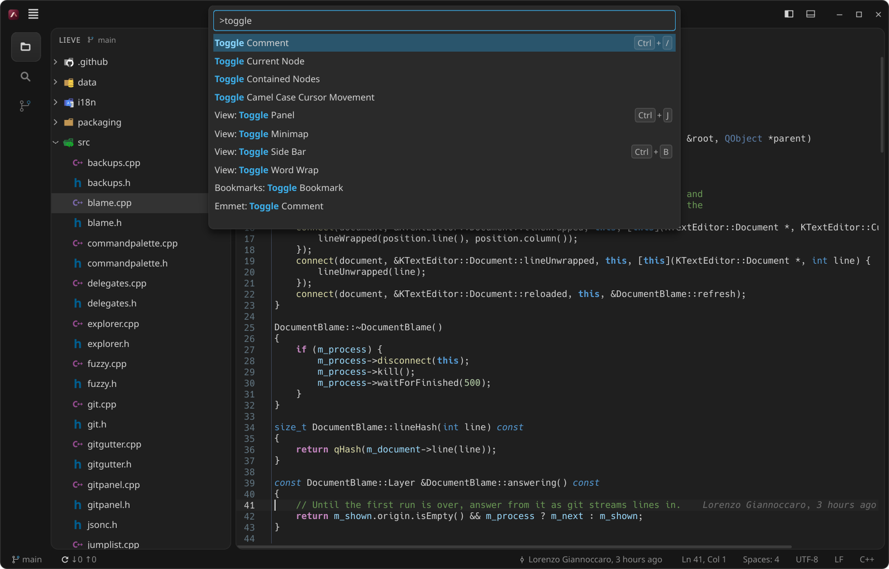
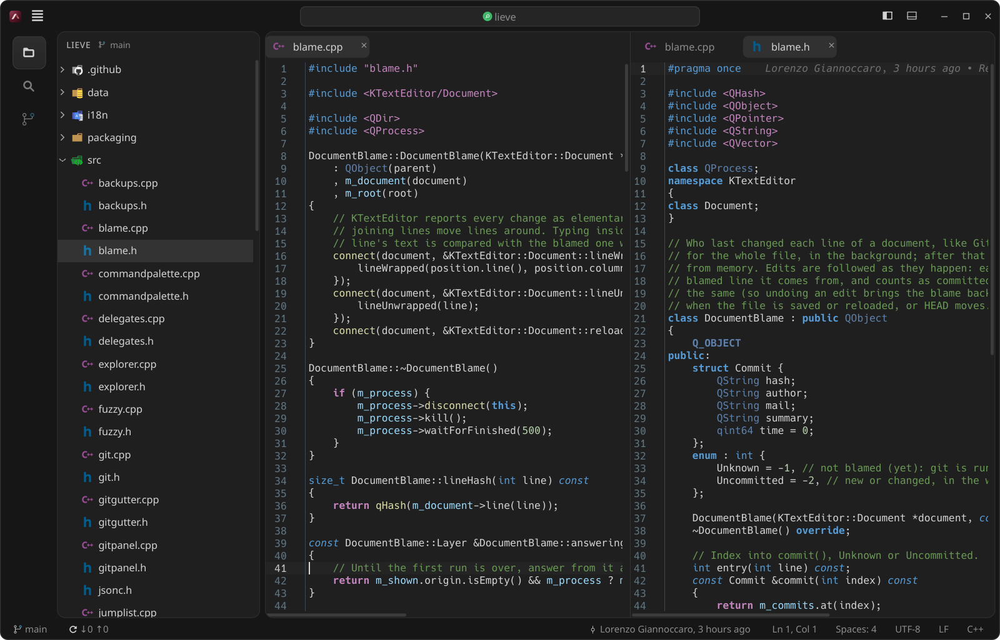
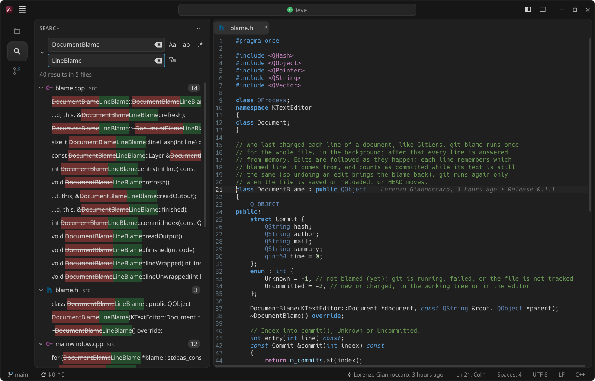
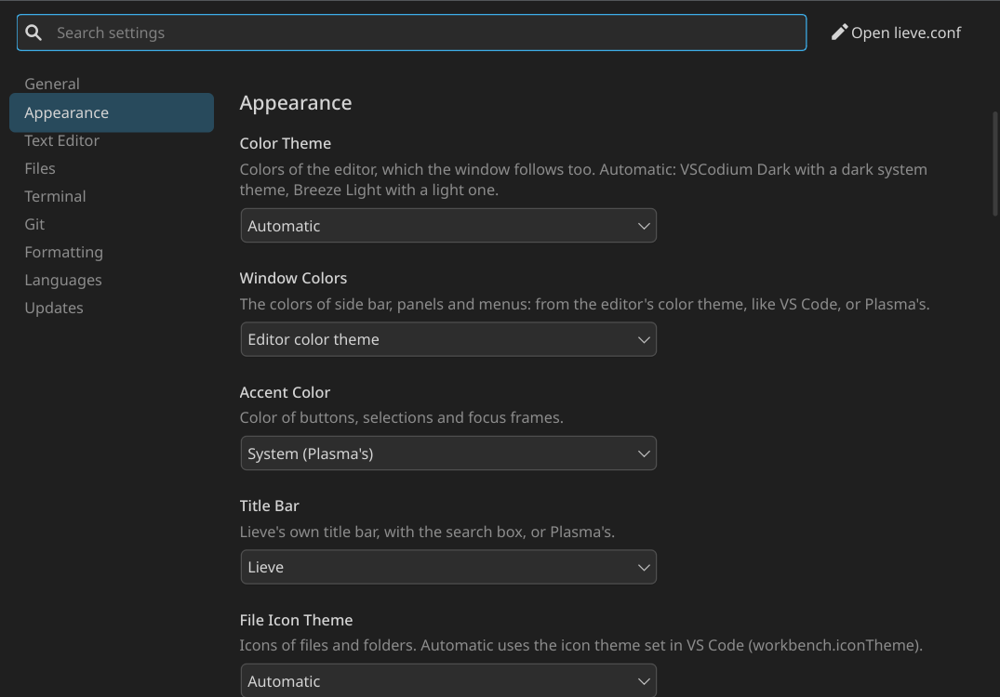

# Lieve



A lightweight, native code editor for KDE Plasma (Qt 6 + KDE Frameworks, no Electron).
It does a few things and does them well: **Explorer**, **Search and replace in files**, **Quick Open**
(`Ctrl+P`) and the **Command Palette** (`Ctrl+Shift+P`), **editor** (also side by side) and **terminal**,
with several projects open at once (one window per project), **Prettier and ESLint on save**, a **Git panel**
with change marks next to the line numbers, inline blame, branches, stashes, history and merge conflicts,
a **Problems** panel, **npm scripts**, a **Markdown preview**, and unsaved files kept across restarts, as in
VS Code. File icons and the main keyboard shortcuts are the ones from VS Code.

*Lieve* is Italian for "light". The interface is in English and Italian and follows the system language.



How heavy it is, measured with the same medium-sized Angular project open in both:

| | VS Code (with its extensions) | Lieve |
| --- | --- | --- |
| Memory (PSS) | ~1,270 MB | ~110 MB |
| Processes / threads | 24 / 434 | 2 / 14 |
| Disk space | ~2.7 GB | ~1.4 MB (plus the KDE libraries Plasma already ships) |

It starts in about a quarter of a second, and each extra open project costs a few MB.
Language intelligence (go to definition, errors, completion) comes from a language server when one is
installed, and costs what it costs in VS Code too: the TypeScript server alone takes over 1 GB on a large
project. Without one, Lieve stays as light as above.

## How it is built

| Part | Component |
| --- | --- |
| Editor | KTextEditor (the same as Kate): highlighting for hundreds of languages, multiple cursors, find/replace, `.editorconfig` |
| Terminal | embedded Konsole (konsolepart): your login shell (or the one you pick) and your Konsole profile |
| Search and `Ctrl+P` | ripgrep (`rg`): honours `.gitignore`, skips `node_modules` |
| File icons | read from the VS Code extensions already installed (`workbench.iconTheme`, e.g. vscode-icons) |
| Editor theme | "VSCodium Dark" with a dark system theme, "Breeze Light" with a light one |
| Window look | colours derived from the editor theme (Qt palette + style sheet), like VS Code |
| Multiple windows | a single process (KDBusService): running `lieve` again hands the request to the open one |
| Formatting | the project's own Prettier and ESLint (`node_modules`), kept loaded by a small Node process |
| Git | the `git` command (status with `--porcelain=v2`), one operation at a time in the background |
| Language intelligence | language servers (LSP) such as `typescript-language-server`, started only when needed |

The code is in `src/` (about 19,400 lines of C++, headers and blank lines included):
`mainwindow` (window, editor groups, tabs, project session), `windowmanager` (windows and single instance),
`projects` and `projectlist` (project list and picker), `jumplist` (taskbar menu),
`explorer`, `searchpanel` (search and replace), `quickopen` and `commandpalette`, `terminalpanel`,
`vscodeicons` (VS Code icons and languages), `prettier` (Prettier and ESLint), `git` and `gitpanel`
(source control), `blame`, `gitgutter` and `linediff` (change marks), `lsp`, `lspclient`, `lspcompletion`
and `symbolpicker` (language servers), `backups` (hot exit), `settingsdialog`, `theme` (look, cards),
`titlebar`, `statusbar`, `tabview` (scrolling tabs), `updater`, `fuzzy`, `settings`.

## Install

You need KDE Plasma 6 (or at least KDE Frameworks 6) with `qt6-base`, `qt6-svg`, `ktexteditor`, `kparts`,
`kdbusaddons`, `kwindowsystem`, `syntax-highlighting`, `ki18n`, `konsole` and `ripgrep`, plus `git`, `gcc`,
`make`, `pkgconf` and `qt6-tools` (for the translations; without it Lieve builds in English only) to build it.
On Arch/CachyOS with Plasma almost everything is already installed. No CMake needed.

The easy way: the script downloads the latest release, builds it and installs it into `~/.local`
(no `sudo`). If something is missing it tells you which packages to install (Arch and Fedora).

```bash
curl -fsSL https://raw.githubusercontent.com/giannoccarol/lieve/main/install.sh | bash
```

Or by hand:

```bash
git clone https://github.com/giannoccarol/lieve.git
cd lieve
make -j$(nproc)
make install        # into ~/.local: bin/lieve, menu entry, icon
```

Uninstall: `make uninstall`.

**Arch Linux / CachyOS**: [`packaging/aur`](packaging/aur) has the PKGBUILDs, `lieve` (latest release) and
`lieve-git` (main branch). Once they are on the AUR: `yay -S lieve`.

### Updates

Lieve checks by itself, shortly after starting and then every 6 hours, whether a new version is out on GitHub.
If there is one, the status bar shows **⬆ Update 0.x.y**: one click shows what's new, and
**Update Now** downloads, builds and installs the new version in the background, in the same
folder Lieve is installed in. When it's done, click **↻ Restart**. The downloaded sources stay in
`~/.local/share/lieve/source`. Turn the check off with `[updates] check=false` in the settings (`Ctrl+,`).
Packages (`make PACKAGED=1`, as the AUR ones) leave updates to the package manager.

## Usage

```bash
lieve                      # project picker
lieve ~/Projects/my-site
lieve src/app/app.component.ts:42   # opens the project (folder with .git) and goes to line 42
lieve --open-folder        # asks which folder to open
```

### Projects and windows

- **At startup** you pick a project: *pinned* first, then *recent*, then every folder found in your
  project folders (detected automatically, e.g. `~/Projects` or `~/Documents/Projects`; a "group" folder
  that contains other repositories lists those directly). Type to filter; `Enter` opens the last one used,
  which is already selected.
- **One window per project**, all in the same process. Each project remembers its own tabs, cursor
  positions, sidebar, terminal and window size.
- **`Ctrl+R`** opens the project picker from any window: `Enter` opens the project in its own window
  (or raises it if it's already open), `Ctrl+Enter` replaces the current window's project. The previous
  project is preselected, so `Ctrl+R` `Enter` switches back and forth.
- Running `lieve` again (from the menu, a terminal, even the built-in one) does not start a second
  program: it opens or raises the right window.
- Right-click a project: **pin to top**, **remove from recent**, copy path, show in file manager.
- **Unsaved changes are kept** (VS Code's hot exit): closing a window, quitting (`Ctrl+Q`) or restarting after
  an update never asks about unsaved files; they come back, still unsaved, when you reopen the project, new
  untitled documents included. While you type they are also backed up every couple of seconds (in
  `~/.local/state/lieve/backups`), so a crash loses nothing. Closing a single tab still asks Save / Don't
  Save / Cancel. `[files] hotExit=false` asks on close as before.

### Command Palette and Quick Open

- **Command Palette** (`Ctrl+Shift+P` or `F1`, or type `>` in Quick Open): every command of the window, the Git
  panel and the current editor, with VS Code-style categories ("View: Toggle Panel"), shortcuts and fuzzy
  matching. Recently used commands come first. Commands with choices open a second list: "Change Language
  Mode", "Change File Encoding", "Change End of Line Sequence".


- **Quick Open** (`Ctrl+P`): files by name, `name:line` to go to a line. `Ctrl+G` (or a click on Ln/Col)
  opens it with `:` to go to a line of the current file (`:42` or `:42:7`); deleting `>` or `:` goes back
  to files.

### Editor groups



`Ctrl+\` shows the current file again in a group on the right, like VS Code's split editor; `Ctrl+1`,
`Ctrl+2`, `Ctrl+3` focus a group (the next number splits). Each group has its own tabs; a file open in two
groups is one document, so edits show in both, and closing one of its tabs keeps the other. An emptied group
goes away. (The session reopens the files in a single group.)

### Breadcrumbs and sticky scroll

Above the editor, the **breadcrumbs** show where you are: the file's folders, the file, then the class,
function or block around the cursor (`src › app › shop.ts › Shop › checkout`). Click a folder to browse it
and open a file, click the file or a symbol to jump to another symbol at that level.

While you scroll, **sticky scroll** keeps the first lines of the blocks you are in (class, function, `if`,
loop…) at the top of the editor, with their line numbers, up to five; click one to go there.

Both use the language server's symbols when there is one, otherwise Lieve works the blocks out from the text
itself (braces, or indentation for Python, YAML and the like; headings in Markdown), so they work in any
language. Turn them off with **View: Toggle Breadcrumbs** / **View: Toggle Sticky Scroll**, in the Settings
window, or with `[editor] breadcrumbs=false` / `stickyScroll=false`.

### Markdown preview

`Ctrl+K V` opens the preview of a Markdown file in the group beside it, `Ctrl+Shift+V` in the same group (press
it again to go back to the source); the button at the right of the tab bar does the same. It follows GitHub's
Markdown (tables, task lists, code blocks in the editor's font, images next to the file), updates as you type
and scrolls with the editor. It is drawn by Qt itself, without a web engine, so it costs next to nothing.
Preview tabs are not reopened at the next start.

### Language intelligence (language servers)

When a language server is installed, Lieve uses it, like VS Code does through its extensions:

- **Go to Definition**: `F12` or `Ctrl+click` (`Alt+←` / `Alt+→` to go back and forward).
- **Problems** underlined as you type, the message on hover, a count (⊗ errors ⚠ warnings) in the status bar;
  `F8` / `Shift+F8` go to the next / previous one.
- **Problems panel** (`Ctrl+Shift+M`, or click the count in the status bar): a tab next to the terminals that
  lists the problems of the open files, grouped by file, errors first; click one (or `Enter`) to jump to it.
- **Hover** information, **completion** with auto-imports, **Go to Symbol in File** (`Ctrl+Shift+O`).

TypeScript and JavaScript use `typescript-language-server` with the project's own TypeScript:

```bash
npm install -g typescript-language-server
```

A server starts only when you open a file of its language, one per project window; it stops a few minutes
after its last file is closed and when the window closes. Without a server nothing changes. Angular
templates (`.html`) can use `@angular/language-server`, but it takes several GB on large projects, so it is
off until you set `[lsp] angular=auto`. The `[lsp]` section of `lieve.conf` also has custom server
commands, the idle minutes and a memory cap for tsserver (`enabled=false` turns it all off).

### Search and replace

`Ctrl+Shift+F` searches the project with ripgrep (case, whole word, regular expressions, files to include and
exclude). `Ctrl+Shift+H` (or the chevron next to the search box) shows a **Replace** field:



- Results preview the change inline (old text struck out, new text highlighted); **Replace All** asks first.
- Hover a result to replace or dismiss a single line, or a whole file. With regular expressions the
  replacement understands `$1`, `$&`, `\n` and `\u \l \U \L`.
- Files open in the editor are changed in their document as one undo step, without saving. Other files are
  rewritten only if they are UTF-8 text, keeping BOM, line endings and permissions. Lines changed since the
  search are never touched.

### Terminal

`Ctrl+J` shows the terminal panel, `` Ctrl+Shift+` `` (or **+**) opens a new terminal in the project folder.

- New terminals run your **login shell** (the one set with `chsh`, e.g. fish), not `$SHELL`.
- The **⌄** button next to **+** lists the shells installed on the system (from `/etc/shells`): pick one to
  open a terminal with it, or set it as the default under **Default Shell**.
  The choice is saved in `lieve.conf` (`[terminal] shell=`) and applies to every window.
- `[terminal] shell=` takes `auto` (the login shell), a name such as `fish`, `zsh`, `bash`, or a full path.

### npm scripts

When the project has a `package.json` (at the top or one folder down), the Explorer shows an **NPM SCRIPTS**
section under the files, like VS Code: click ▶ (or double-click the script) to run it in a new terminal tab
named after it, in the package's folder. It uses `npm run`, or `pnpm`, `yarn` or `bun` when the project has
their lock file. The command is typed into your shell, so the terminal stays open afterwards and `↑ Enter`
runs it again. **Tasks: Run npm Script…** and **Tasks: Rerun Last Script** are in the Command Palette;
right-click a script to open `package.json` at its line. Click the section title to fold it.

### Prettier and ESLint on save

It follows the same rules as VS Code, read from your settings: `editor.formatOnSave` and
`prettier.requireConfig` from the project's `.vscode/settings.json` or from your VS Code user settings,
plus `.prettierrc` (with its plugins), `.prettierignore` and `.editorconfig`.

- **ESLint fix on save**: when `editor.codeActionsOnSave` asks for `source.fixAll.eslint` (as Angular projects
  usually do), Lieve runs the project's own ESLint "fix all" before Prettier on every save, as one undo step.
  It stays loaded in a worker thread of the same Node process, so saves stay fast; if it takes too long the
  file is saved with Prettier only. Flat and legacy configs, `eslint.validate` and ignore files are respected.
  `[format] eslint=auto|true|false`; with ESLint loaded the Node process takes about 200 MB more.
- **Format Document** (`Ctrl+Shift+I`) runs the same steps; **Save without Formatting** skips both.

- It uses the Prettier installed in the project (`node_modules/prettier`): projects without Prettier are left alone.
- Formatting happens right before writing: the file is written once (so `ng serve` rebuilds once).
  The cursor stays where it was and a single `Ctrl+Z` undoes it.
- A small Node process keeps Prettier loaded: it starts when you begin editing a file and exits after
  10 minutes of inactivity (`[format] keepAliveMinutes=`). It is tuned to stay small: about 150 MB
  with a large Angular project. Saving takes about 10-100 ms (the very first time about half a second).
- If the file has a syntax error it is saved as it is and a notice appears at the bottom of the editor.
- Node is looked up in `PATH` and in version managers (mise, volta, nvm, fnm), even when Lieve is started
  from the menu; you can set it by hand in `[format] node=`.

### Source control (Git)

`Ctrl+Shift+G`, or the branch icon in the activity bar, which shows the number of changes.

- **Staged changes** and **Changes** sections (plus **Merge conflicts** when there are any), with file icons
  and VS Code's letters: M modified, A added, D deleted (struck through), R renamed, U untracked, ! conflict.
- Hovering a file or a section shows its buttons: **+** stage, **−** unstage, **discard changes** (asks first;
  new files go to the trash), **open file**.
- **Click** a file: its diff in a read-only tab, added lines in green and removed lines in red.
  **Double-click**: open the file.
- Message and **Commit** (`Ctrl+Enter`). The menu next to it has: amend last commit, commit and push,
  commit and sync. If nothing is staged and `git.enableSmartCommit` is on (as in your VS Code settings),
  the commit includes all changes; otherwise it asks.
- With no changes the button becomes **Sync changes ↓ ↑** (pull and push), or **Publish branch** when the
  branch isn't on the server yet. The ⋮ menu has pull, push, fetch, stage/unstage all and **undo last commit**
  (the message goes back into the box).
- It refreshes by itself: on save, when `.git` changes (also for commands typed in the terminal), when you
  come back to the window and every 10 seconds. With `git.autofetch` on it fetches every 3 minutes, never
  asking for a password in the background.
- Git hooks (husky, lint-staged…) find `node` even when Lieve is started from the menu.
- **Branches**: click the branch name in the status bar (or **Git: Checkout to…** in the Command Palette) to
  switch branch, with the most recent first, ahead/behind counts and the remote branches; or create a new one
  (also from another branch). Files open in the editor reload with the new branch's content.
- **Stash** (in the ⋮ menu and the Command Palette): stash, also with untracked files, with an optional
  message; apply, pop or drop one from the list (dropping asks first).
- **History**: **View History** and **View File History** (⋮ menu, Command Palette, tab menu) list the
  commits, searchable by message, author or hash; pick one to see its changes in a read-only tab.
- **Merge conflicts**: in a file with conflict markers the current and incoming changes are tinted green and
  blue, and the `<<<<<<<` line offers **Accept Current Change | Accept Incoming Change | Accept Both Changes**
  (one undo step each). The Command Palette has the next/previous conflict and accept-all commands.
- **Change marks next to the line numbers** (VS Code's quick diff): a thin bar on lines added (green) or
  modified (blue) and a red wedge where lines were deleted, comparing the editor's text (unsaved edits
  included) with the staged version. Staging a change makes its marks go away; click a mark to open the diff
  at that change; `Shift+Alt+F3` / `Alt+F3` go to the previous / next change (Plasma keeps `Alt+F3` for
  the window menu unless you free it). Git reads the file once, edits are compared in memory.
  `[git] gutter=false` turns them off.
- **Inline blame**, like GitLens: at the end of the cursor line, in grey, who changed it, when and the commit
  message ("Jane Doe, 1 year ago • fix: …"); uncommitted lines say "You, now". git blame runs once per
  file, in the background, and edits are followed in memory, so moving between lines is instant.
  Turn it off with `[git] inlineBlame=false`.

### Look

The whole window takes its colours from the editor theme, as VS Code does. Sidebar, editor and terminal are
**cards with rounded corners**, separated by small gaps on a darker background; file and terminal tabs are
**pills**, and the tab row **scrolls** with the mouse wheel (no arrows).

The **title bar** is Lieve's own: menu on the left, in the middle a box with the project name that opens
`Ctrl+P`, on the right sidebar / terminal toggles and Breeze-style window buttons (a circle on hover, red on
close). Drag it to move the window, double-click to maximise, and use the edges (the gaps around the cards)
to resize. `[ui] titleBar=system` brings back Plasma's title bar.

At the bottom there is a **status bar**: on the left the branch (click: Git panel) and ↓↑ to sync
(click: sync); on the right who wrote the current line and when ("You, 6 months ago", like GitLens, computed on
the text in the editor), line and column (click: go to line), spaces/tabs (click: change), encoding, line ending
and language (click: their menus), ✓ ESLint / ✓ Prettier (click: format now). The × on tabs shows on the active tab and on hover.

The rest: sidebars and tabs a little darker than the editor, thin borders, slim scrollbars without a track,
a single accent colour (active tab, Commit button, focused fields, counters); the active item in the activity
bar sits on a rounded tile. Light themes work too.

- Pick the accent colour with `[ui] accent=`: `system` (Plasma's), `lieve` (the burgundy of the icon)
  or a `#rrggbb` colour.
- `[ui] theme=system` goes back to Plasma's colours for the window.
- The terminal uses the same colours through a private Konsole profile
  (`~/.local/share/lieve/xdg/konsole/`): the Konsole app and your profiles are not touched.
  Turn it off with `[terminal] matchEditor=false`.

### Taskbar menu

Right-click Lieve's icon (taskbar or application launcher) to get your pinned and recent projects (up to 8),
**Choose Project…** and **Open Folder…**. Lieve keeps these entries up to
date in `~/.local/share/applications/lieve.desktop` (only for the one installed by `make install`, which
carries the line `X-Lieve-JumpList=true`).

### Keyboard shortcuts

| Action | Keys |
| --- | --- |
| Quick Open (`name:line` to go to a line) | `Ctrl+P` |
| Command Palette | `Ctrl+Shift+P` or `F1` |
| Search in files (uses the selected text) | `Ctrl+Shift+F` |
| Replace in files | `Ctrl+Shift+H` |
| Explorer | `Ctrl+Shift+E` |
| Show/hide sidebar | `Ctrl+B` |
| Show/hide terminal | `Ctrl+J` |
| Focus terminal / back to editor | `` Ctrl+` `` or `Ctrl+ò` |
| New terminal | `` Ctrl+Shift+` `` or the `+` button |
| Switch project | `Ctrl+R` |
| Source control (Git) | `Ctrl+Shift+G` |
| Commit (from the message box) | `Ctrl+Enter` |
| Open folder | `Ctrl+K` then `Ctrl+O` |
| New window (project picker) | `Ctrl+Shift+N` |
| Close project (back to the picker) | `Ctrl+K` then `F` |
| Close window / quit everything | `Ctrl+Shift+W` / `Ctrl+Q` |
| Save / Save all | `Ctrl+S` / `Ctrl+K` then `S` |
| Format document (Prettier) | `Ctrl+Shift+I` or `Shift+Alt+F` |
| Save without formatting | `Ctrl+K` then `Ctrl+Shift+S` |
| Close tab | `Ctrl+W` (or middle-click the tab) |
| Next / previous tab | `Ctrl+Tab` / `Ctrl+Shift+Tab` |
| Split editor / focus group 1, 2, 3 | `Ctrl+\` / `Ctrl+1`, `Ctrl+2`, `Ctrl+3` |
| Next / previous change | `Alt+F3` / `Shift+Alt+F3` |
| Go to definition / back | `F12` or `Ctrl+click` / `Alt+←` |
| Go to symbol in file | `Ctrl+Shift+O` |
| Next / previous problem | `F8` / `Shift+F8` |
| Problems panel | `Ctrl+Shift+M` |
| Markdown preview to the side / in place | `Ctrl+K` then `V` / `Ctrl+Shift+V` |
| Trigger completion | `Ctrl+Space` |
| Find / replace in file | `Ctrl+F` / `Ctrl+H` |
| Go to line (Quick Open with `:`) | `Ctrl+G` |
| Select next occurrence / all | `Ctrl+D` / `Ctrl+Shift+L` |
| Move / duplicate lines | `Alt+↑↓` / `Alt+Shift+↑↓` |
| Delete line | `Ctrl+Shift+K` |
| Toggle comment | `Ctrl+/` |
| Settings | `Ctrl+,` |

In the terminal Lieve keeps only `Ctrl+P`, `Ctrl+Shift+P`, `F1`, `Ctrl+J`, `Ctrl+Shift+E/F` and `` Ctrl+` ``:
every other key goes to the shell (including `Ctrl+R`, history search).

In the Explorer: click to open, `F2` renames, `Delete` moves to the trash,
right-click for new file/folder, copy path, open in terminal.

## Language

Lieve speaks the system language when it has a translation for it (today English and Italian), and English
otherwise. To pick one yourself, set `[ui] language=` in the settings to `en` or `it` (`auto` follows the
system) and restart. The editor and terminal, which come from KDE, follow the same choice.

Translations live in `i18n/` as Qt Linguist files. To add a language:

```bash
make translations TS=i18n/lieve_de.ts   # creates the file with every string of the interface
linguist i18n/lieve_de.ts               # translate (or edit the XML by hand)
make                                    # builds it into Lieve
```

After changing strings in the code, `make translations` updates every `.ts` file.

## Settings

`Ctrl+,` opens the **Settings window**, like VS Code's: a search box, categories (General, Appearance, Text
Editor, Files, Terminal, Git, Formatting, Languages, Updates) and each option with a short description and its
control. Changes are saved at once in `~/.config/lieve/lieve.conf`, keeping its comments; font, minimap, word
wrap and inline blame apply at once, options that need a restart are marked and offer a **Restart** button
that reopens your projects. **Open lieve.conf** edits the file itself (commented, one key per option).



Recent and pinned projects, and each project's session, are stored in `~/.local/state/lieve/state.ini`.

## Development

- `make check` runs the tests in `tests/` (they need git and no display); GitHub Actions runs them before
  every build and release.
- `make translations` refreshes the strings in `i18n/*.ts` after changing them in the code.
- `packaging/aur` has the AUR packages and how they are published.

## Releasing a new version

Versions go up one step at a time: 0.1.0, 0.1.1, 0.1.2, …

1. Bump the number in `src/version.h`.
2. Add a `## v0.1.x` section at the top of `CHANGELOG.md` with what's new.
3. Commit, then create the tag and push it:

```bash
git tag v0.1.2
git push origin main v0.1.2
```

GitHub Actions builds Lieve on Arch Linux, checks that the tag matches `src/version.h` and creates the
release with the notes taken from `CHANGELOG.md`. Everyone who has Lieve installed sees it in the status bar.

## License

Lieve is free software, released under the GNU General Public License version 3 (see [LICENSE](LICENSE)).
Copyright © 2026 Lorenzo Giannoccaro.

## Credits

Lieve puts together components written by others; the credit for the heavy lifting is theirs.

- **KDE Community**: [KTextEditor](https://invent.kde.org/frameworks/ktexteditor) and
  [KSyntaxHighlighting](https://invent.kde.org/frameworks/syntax-highlighting) (editor and highlighting,
  including the "VSCodium Dark" theme), [Konsole](https://invent.kde.org/utilities/konsole) (terminal),
  [KParts](https://invent.kde.org/frameworks/kparts), KXmlGui, KCoreAddons, KDBusAddons (single instance),
  KWindowSystem (window activation on Wayland). LGPL/GPL licences.
- **The Qt Company and contributors**: [Qt 6](https://www.qt.io/). The Markdown preview uses Qt's Markdown
  support, built on [MD4C](https://github.com/mity/md4c) by Martin Mitáš (MIT).
- **Andrew Gallant (BurntSushi)**: [ripgrep](https://github.com/BurntSushi/ripgrep), used for search and `Ctrl+P`.
- **vscode-icons team**: [vscode-icons](https://github.com/vscode-icons/vscode-icons) (MIT code, CC BY-SA icons).
  The icons are not included in Lieve: they are read from the extension installed in VS Code.
  The same goes for [Material Icon Theme](https://github.com/material-extensions/vscode-material-icon-theme)
  by Philipp Kief, if that is the chosen theme.
- **Git** (Linus Torvalds, Junio C Hamano and contributors, GPLv2): Lieve uses the installed `git` command.
- **Prettier** (James Long and contributors, MIT), **ESLint** (Nicholas C. Zakas and contributors, OpenJS
  Foundation, MIT) and **Node.js**: Lieve uses the copies already installed in the project and bundles none.
- **Language servers**: [typescript-language-server](https://github.com/typescript-language-server/typescript-language-server)
  (TypeFox and contributors, Apache-2.0) with Microsoft's TypeScript (`tsserver`), and the
  [Angular Language Service](https://github.com/angular/vscode-ng-language-service) (Google, MIT), when
  installed. The [Language Server Protocol](https://microsoft.github.io/language-server-protocol/) is Microsoft's.
- **Microsoft**: language definitions (file extensions) are read from the built-in extensions of the
  installed [Visual Studio Code](https://github.com/microsoft/vscode).
- Layout, shortcuts, the command palette, quick diff, hot exit, the settings window, the Problems panel, the
  NPM SCRIPTS view, the merge conflict actions and colours, the branch/stash/history pickers, the Markdown
  preview, the breadcrumbs and sticky scroll (which lines stay and what a click does) are modelled on
  [Visual Studio Code](https://github.com/microsoft/vscode)'s (Microsoft, MIT).
- The line numbers of the sticky lines are laid out like KTextEditor's own line number border
  (`KateIconBorder::paintBorder` in `kateviewhelpers.cpp`, KDE, LGPL).
